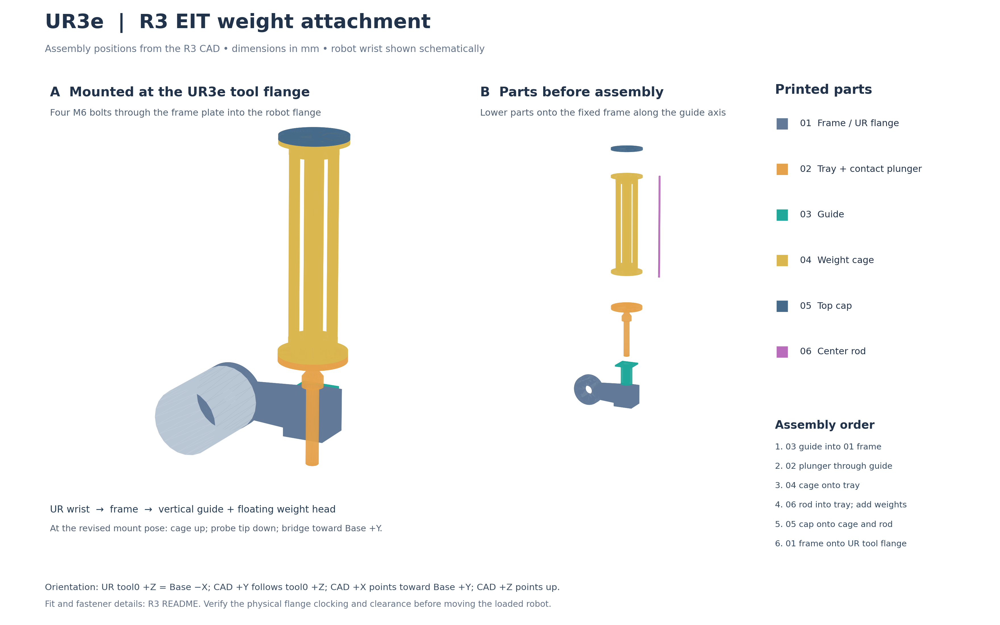
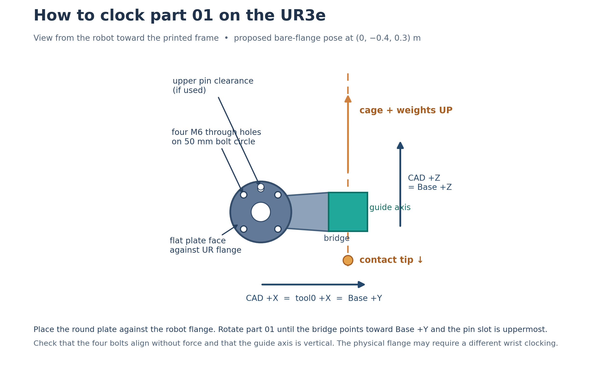

# UR3e weighted EIT position collection

This folder contains the UR3e deadweight collection workflow for weight-and-position training data, including fixture setup, pad calibration and weighted EIT scans. Manual position-only collection, RBF/MLP training and live testing are maintained in [eit_position_toolkit](../../eit_position_toolkit/README.md). Existing position-only sessions and models have moved to `../../eit_position_toolkit/contact_position_runs/`; their session folder names are unchanged. Signal diagnostic reports and preview images have moved to `../../eit_position_toolkit/signal_diagnostics/`.

This folder records static EIT measurements at known positions with a weighted robot collector. The serial reader supports either 8 or 16 electrodes; the current configuration uses 16. The UR3e moves the [R3 deadweight attachment](../ur3e_weight_position_data_gather_attachment/R3/README.md) with slow Cartesian `movel` commands. One invocation records one weight configuration in a unique run directory. `eit_reader.py` reads the Amodo ARIA EITSYS device through USB serial, following the Python examples and firmware in `../../Amodo Files/Firmware/ARIA_EITSYS_FW-v1.1.1.zip`. `--metadata-only` explicitly runs a motion check and writes null EIT fields.

The collector imports the read-only RTDE transport, Dashboard checks and primary-interface script upload from `../../../00_VMC_demo_ur3e/ur3e_demo/rtde.py`. It does not run that demo's torque or force controller. The robot must be a UR3e in Remote Control with a correctly configured active TCP and payload. All robot coordinates are metres in the UR Base frame; pad coordinates are relative to the calibrated center.

## EIT connection and acquisition settings

Install the Python dependencies from this folder:

```bash
python3 -m pip install -r requirements.txt
```

Power the EIT with its supplied 24 V DC barrel-jack adapter and connect a USB data cable to **USB - HS**. Blue **POWER** indicates external power; green **STAT2** indicates USB enumeration. USB - FS is unused by the bundled firmware. The collector configures and starts acquisition automatically at the raised, untouched pose.

Set `eit_port` in `config.json` to the device's persistent `/dev/serial/by-id/` path. If opening the USB port reports **Permission denied**, grant access to the current device in your terminal:

```bash
sudo setfacl -m u:"$USER":rw /dev/ttyACM0
```

Check `ls -l /dev/serial/by-id/` and substitute the actual device if its number changed. Retry collection after granting access; the permission may need repeating after reconnecting USB. For persistent group access, run `sudo usermod -aG dialout "$USER"`, then sign out and back in. See the toolkit's [USB port instructions](../../eit_position_toolkit/README.md#usb-port-permissions) for an immediate group-enabled shell.

The acquisition settings remain local to this collector. The current configuration uses 16 electrodes on pins 1–16, in physical order around the pad, a combined scan (304 measurements/frame), 50 kHz, one period and five frames per capture. `eit_rx_gain_margin_steps: 2` applies two extra RX gain halvings after autogain, preserving TX gains and verifying the active gain dump before streaming. Set this before starting a new run; 0–14 steps are supported. `eit_allow_clipped: true` currently accepts flagged measurements and preserves their flags. Accepting a clipped value cannot repair its distortion. Inspect representative untouched and weighted-contact signals in the toolkit before collection, closing it before starting the collector so only one application reads the device.

## Move to a pose for mounting the attachment

The figure below shows the six R3 printed parts in their **assembled** positions and an exploded view. The gray cylinder represents the UR3e wrist at the tool flange; the printed part geometry comes from the R3 CAD. Attach the round plate of **01 fixed frame** to the robot tool flange with four M6 bolts. The bridge then extends sideways to the vertical guide; the weight cage stands above it and the contact tip points down. See the [full-size PNG](figures/r3_ur3e_attachment_assembly.png) or [PDF](figures/r3_ur3e_attachment_assembly.pdf) for a larger view. The STL files are oriented for printing, so their file orientation is not the installed orientation.



**Part 01 is asymmetric.** At the revised mounting pose, place its flat round plate against the UR3e tool flange and hold the frame so its bridge runs toward **Base +Y** and its guide block sits at the far end of that bridge. The optional pin clearance slot in the round plate is then **above** the plate center; the cage will stand up and the plunger tip will point down. The view below shows the robot-facing side of part 01 in this orientation. The slot is clearance only; it does not locate the plate precisely.



Align all four M6 holes without forcing the printed plate or the robot's locating pin. Install the four M6 fasteners and washers as specified in the [R3 hardware instructions](../ur3e_weight_position_data_gather_attachment/R3/README.md#hardware---metal-fasteners-only), and check the actual bolt projection into the UR flange. If the holes or pin clearance do not fit with the bridge in this direction, stop: the proposed wrist rotation does not match the physical flange clocking. Teach a different **bare-flange** mounting pose with the pendant and record it with `python mount_pose.py record`, then measure the mounted tool transform before scanning. Do not turn part 01 a quarter-turn and assume the current TCP and tip coordinates still apply.

The revised **bare-flange pose** is `(x, y, z) = (0, -0.4, 0.3)` m in UR Base, with rotation vector `(rx, ry, rz) = (-1.2092, -1.2092, 1.2092)` rad. Its orientation is 180 degrees about **UR Base Z** from the original target, and its flange is 0.2 m farther along Base `-Y`. The tool0 axes point `X` toward Base `+Y`, `Y` down, and `Z` toward Base `-X`. Mount the R3 plate so the bridge from its flange toward the guide (CAD `+X`) points toward Base `+Y`, and its cage points up (CAD `+Z` toward Base `+Z`). The CAD tip is then nominally at `(0, -0.31, 0.25)` m. This is a mounting location above the pad region, not the pad contact pose. The approximate CAD envelope reaches to about 0.56 m above Base. The original pose reached on the physical robot lacked cage space; the revised pose has **not** been checked for physical clearance. Check the wrist, full cage and surrounding fixtures before attaching the assembly. With this mounting clocking, a **nominal** guide-axis TCP at CAD height `z=-50 mm` has tool0 offset `[0.09, 0, 0, 0, 0, 0]` and probe direction `[0, 1, 0]` in the TCP frame; measure the assembled fixture before entering these in `config.json`.

The proposed pose is reachable in the bundled UR3e model. The model does not establish clearance for the physical installation. `config.json` contains `robot_ip: 192.168.1.200` from the previous demonstration; verify the address on the robot. With the R3 attachment **off**, inspect the proposal:

`move` sets the robot's active TCP to the bare flange (all six offsets zero) through a short URScript command if needed, then verifies the offset through RTDE. This changes the active robot TCP even during inspection, but does not move the robot without `--execute`. It stops an existing robot program before setting the TCP. If the R3 attachment is still installed, remove it before running this command. The 20.3 mm TCP from the earlier torque demo is for another tool; set the measured R3 TCP after mounting the new attachment.

```bash
python mount_pose.py move
```

`move` no longer needs `mount_pose.json`. It prints the proposed flange and tip positions and the difference from the current robot pose without motion. The proposed move can now start from any stationary pose with an inverse-kinematics solution. It follows a joint-space `movej` path, so a large orientation change can sweep the wrist and arm through a wide region. Inspect the full path with the attachment off before executing:

```bash
python mount_pose.py move --execute --path-clear-verified
```

The robot controller checks inverse kinematics with the current joint angles as its reference, following the [URScript inverse-kinematics interface](https://www.universal-robots.com/manuals/EN/HTML/SW5_20/Content/prod-scriptmanual/G5/get_inverse_kin_has_solution.htm). It uses joint position control at 0.1 rad/s and 0.2 rad/s², monitors measured joint speed and final TCP pose, and sends Dashboard stop on an error. The timeout is 180 seconds to accommodate a longer joint-space move. Once the robot is stationary at the mounting pose, support and attach the R3 assembly. The collection scan uses a separate calibrated tool TCP and begins only after mounting and pad calibration.

If this proposal conflicts with the physical installation, `python mount_pose.py record` still stores a pendant-taught bare-flange pose, and `python mount_pose.py move-saved` inspects it. `move-saved --execute --path-clear-verified` returns to that custom pose from nearby.

## Mount and measure the R3 fixture pose

The CAD assembly uses its own axes. Its flange center is at `(-90, 0, -50)` mm and its tip is at `(0, 0, -100)` mm in those axes. The robot flange face is perpendicular to CAD Y; the probe slides along CAD Z. The 90 mm transverse offset is built into the fixed frame. The assembled tool can be clocked around the flange, so these CAD coordinates alone are **not** a UR TCP setting. Measure the actual mounted tool transform and enter it in `config.json` as `expected_tcp_offset_pose`. Put the TCP origin on the **fixed guide axis**, at a convenient reference height. The moving tip is free in Z and cannot serve as a rigid TCP. Verify the probe center in XY against a physical mark after setting the TCP.

Enter `probe_axis_in_tcp`, the unit vector pointing from the cage toward the pad, expressed in the active TCP frame. Derive it from the mounted CAD direction `(0, 0, -1)`, including the actual mounting rotation and the TCP rotation. Check it by holding the pad level and viewing the guide from two perpendicular directions. The program rotates this vector into Base and requires it to point down within 2 degrees at every calibration and scan pose. It also checks that the robot flange normal is perpendicular to the probe axis, as in the R3 CAD, and requires the active TCP offset to place the guide axis 80–110 mm transversely from the flange center. These checks catch a tilted or incorrectly entered pose; they cannot prove that the wrist, 310 mm tall fixture, cage, cable, weights and nearby objects have collision clearance. Inspect the entire path at the loaded mass, including the full 15 mm lift and the outer scan positions. The `--fixture-clearance-verified` option records that inspection as an operator action.

Weigh the entire moving head and each set of added weights. Set the active UR payload and center of gravity for the mounted assembly, then enter those values in `expected_payload_kg` and `expected_payload_cog_m`. Update these values when the weight changes. The nominal normal force label is `(moving head mass + added mass) × 9.81 N`, provided the shaft slides freely and no other part carries the load. Perform the scale checks in the R3 README before treating this label as measured force.

Once the values are entered, place the robot in a stationary trial pose and run `python collect.py inspect-pose`. This read-only check reports the Base TCP pose and probe tilt, and rejects a TCP or payload mismatch. Do it before recording rim marks and after changing the weight.

## Find the pad center

Mount the R3 attachment on the robot and set its measured TCP, probe direction, and payload in `config.json` first. Fix the pad to a level, rigid backing. The adjacent simulation models a 90 mm active disk inside a 130 mm device; measure the physical pad's active diameter and update `active_radius_m` if it differs. Mark four opposite points on the active boundary: east, west, north, and south. These are marks on the pad, not robot coordinates.

Record **one mark at a time**. Start `python collect.py calibrate east`; the program waits at a prompt. While it waits, jog the robot **manually with the pendant** until the fixed guide axis is vertically over the east mark. Keep the moving tip and the rest of the attachment clear of the pad, stop the robot, and press Enter. The program then opens a read-only RTDE connection, checks that the robot is stationary and the attachment points down, records the current TCP pose, and exits. Repeat the same sequence for west, north, and south, holding the same robot orientation and clearance height. No `calibrate` command sends a motion command.

```bash
cd '/media/yi/Yi Cam data/09_EIT_vmc/ur3e_weight_position_data_collection/ur3e_code'
python collect.py calibrate east
python collect.py calibrate west
python collect.py calibrate north
python collect.py calibrate south
```

The software averages opposite rim points to calculate the center. It checks that the two midpoints agree within 3 mm, the marked radius matches `active_radius_m` within 5 mm, the rim poses have similar height, and the axes are nearly perpendicular. `pad_calibration.json` stores the measured Base-frame center and pad axes. If the pad, flange mount, active TCP or fixture moves, start a new calibration file.

For the fifth mark, start `python collect.py calibrate contact` and use the pendant to move the mounted attachment over the calculated center while the program waits. With the shoulder carrying the moving head, descend slowly until the tip is supported by the pad. Lower the fixed guide about **2 mm farther**, leaving a visible shoulder gap as specified by the R3 design. Stop the robot, then press Enter to record the **guide TCP pose** at this measurement height. The program does not perform this descent.

```bash
python collect.py calibrate contact
```

Keep the four rim captures at least 3 mm above this contact reference. `contact` defines the robot's guide height for the entire scan; it is not a measurement of the floating tip's Z position. Inspect shoulder clearance at the center and edge positions. Recheck on the scale that a 2 mm guide gap does not change the load reading. The default 15 mm travel lift should recapture the shoulder and lift the tip fully clear before sideways motion; verify this visually on the assembled tool.

## Inspect and collect

Fill the `null` values in `config.json` from the actual robot and tool. In particular, do not copy the 20.3 mm TCP offset or 0.1 kg payload from the torque demo: those describe another tool. The default `active_radius_m` value is 45 mm from the simulation model. The grid reserves 5 mm for the contact face radius plus `edge_margin_m`, so the complete 10 mm flat stays inside the active disk. Plan the positions without connecting to the robot:

```bash
python collect.py scan --weight-id W000 --added-mass-kg 0 --moving-mass-kg 0.250
```

A physical motion check, once calibration and fixture clearance are confirmed:

```bash
python collect.py scan --weight-id W000 --added-mass-kg 0 --moving-mass-kg 0.250 \
  --execute --metadata-only --fixture-clearance-verified
```

For a data run, install the dependencies with `python3 -m pip install -r requirements.txt`, verify `eit_electrode_pins`, and remove `--metadata-only`. The pin list gives the 8 or 16 **device connector pins** in physical order around the pad; check the actual wiring or continuity. The Amodo hardware notes include an older board revision with misleading electrode silk labeling. `eit_port` may name the serial device; when null, the reader requires exactly one USB device with the Amodo example's `0483:5740` VID/PID. The host uses the firmware's `RESET`, `FREQKHZ`, `SETPERIODS`, `MODE phase`, `LOAD`, `AUTOGAIN`, `DUMP` and `START` commands. The default 50 kHz and one period follow the Amodo live-view example and can be changed in `config.json` after checking signal quality.

The reader follows `eit_drive_pattern`: adjacent uses N × (N−3) configurations; opposite uses (N/2) × (N−4); combined appends both groups. For the current 16-electrode combined configuration this is 208 + 96 = 304 measurements per frame. Every measurement uses an adjacent sense pair that does not share either drive electrode. Every frame preserves the raw serial line, all voltage magnitudes in Vrms, all phases in radians, and a clipping flag for each measurement. The run manifest stores their exact drive/sense order, electrode/channel counts and the original autogain and active post-margin gain dumps. The firmware stream has no device frame timestamp, so each frame has a host receipt timestamp. At each grid point, the collector takes five fresh frames at the raised no-contact pose and five after the contact settle time. The reader discards frames queued during motion. Repeat the command for each weight with a distinct `--weight-id`; the collector makes a unique timestamped directory under `runs/` and never resumes or overwrites an interrupted run.

Automatic robot motion begins only with `scan --execute`. Before that command, use the pendant to put the robot at the **center travel pose** (`center_contact_tcp_pose` raised by `lift_m`). Each position then follows: horizontal `movel` at travel height, vertical `movel` to the calibrated measurement height, settling and acquisition, then vertical `movel` back to travel height. The script uses at most 5 mm/s and 20 mm/s² by default. It checks the actual TCP after each command, RTDE safety state, active TCP and payload. If a move or acquisition fails, Dashboard `stop` is sent and the run is marked interrupted. Inspect the tool and recover under pendant control; do not assume the tip was lifted after an interruption.

`manifest.json` contains the masses, nominal force, complete calibration and config. `samples.jsonl` contains one record per completed contact dwell: pad XY, commanded TCP, measured arrival and settled TCP poses, UTC timestamp, `eit_baseline` and `eit_contact`. Missing EIT observations are represented only in a motion-check run. Physical clearance, contact load, EIT acquisition and robot accuracy have not been validated by offline code checks.

## Offline checks

```bash
python3 -m unittest discover -p 'test_*.py'
```

These checks cover collection geometry, fixture mounting, serial parsing and gain handling without connecting to the robot or EIT.
